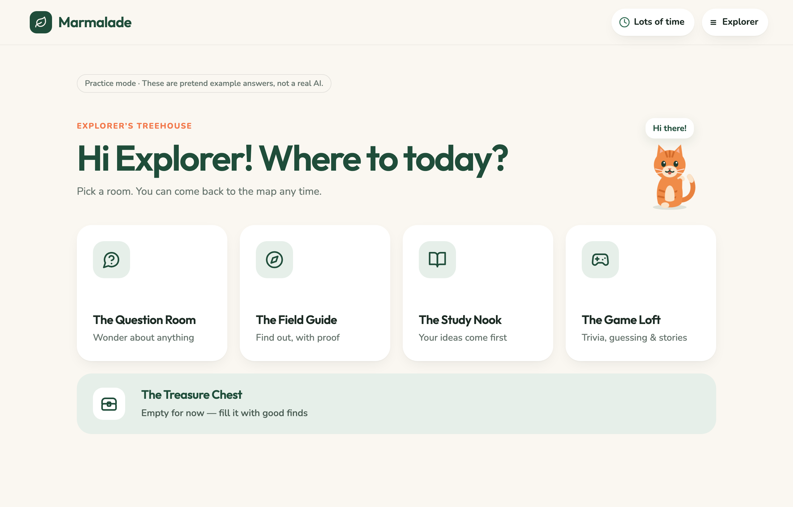
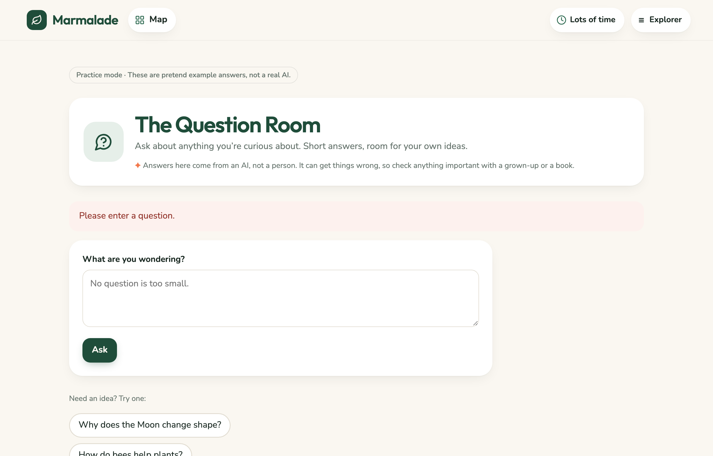
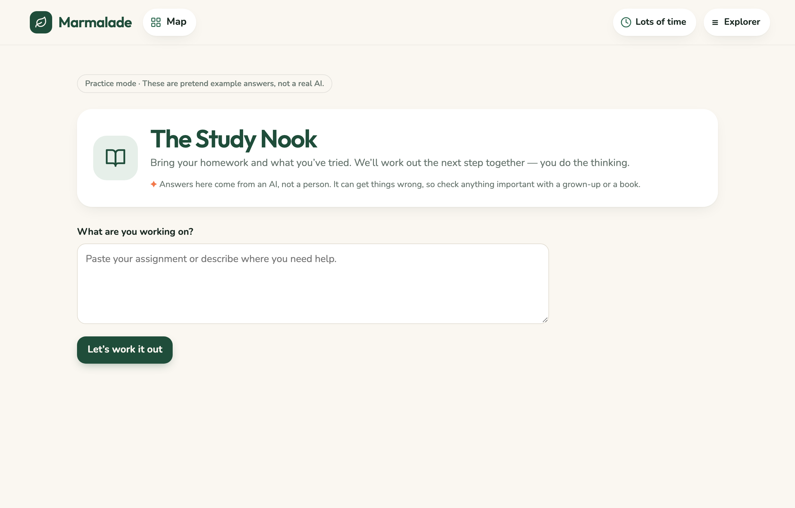
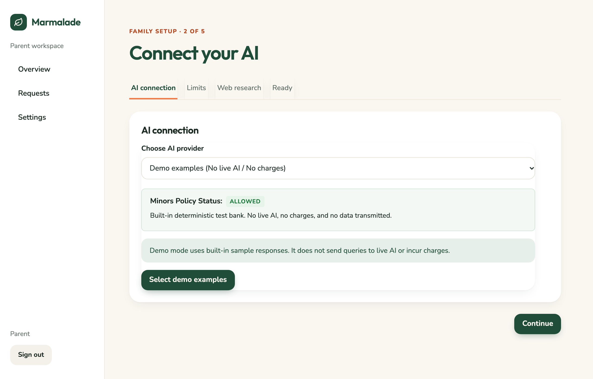

# Marmalade

**Marmalade: a private, self-hosted AI for kids. Parents set the limits. Kids keep their thoughts.**

[](https://github.com/j-nilesh/marmalade/actions/workflows/ci.yml)
[](LICENSE)
[](#private-by-design)
[](#supported-ai-providers)
[](docker-compose.yml)



| Question Room | Study Nook (Socratic Coach) | Parent Dashboard (Zero Transcripts) |
| :---: | :---: | :---: |
|  |  |  |

- Parents govern the technology, not the conversation. There's no transcript reader.
- It stops on purpose. Every activity has a natural end.
- It runs on your hardware, offline with Ollama if you like.

---

## ⚡ Try it in 2 minutes

Run Marmalade with Docker Compose, then jump straight into Demo Mode with no API keys or setup required:

```bash
git clone https://github.com/j-nilesh/marmalade.git
cd marmalade

# Start Marmalade
docker compose up -d
```

Open `http://localhost:4120` in your browser. Marmalade starts in Demo Mode right away so you and your child can explore the treehouse immediately.

---

## Why Marmalade?

General-purpose chatbots were designed for adult productivity and corporate workflows. They lack age-appropriate guardrails, push open-ended engagement loops, and harvest interaction data. Conventional "parental controls" often do the opposite—turning children's private curiosity into an activity feed for parents to monitor.

Marmalade takes a different path:
- **Zero Transcript Surveillance**: The parent dashboard has no transcript reader or chat browser. Parents govern system boundaries, time allowances, and spend limits; children keep their thoughts private.
- **Natural Stopping Points**: Activities don't trap kids in infinite scroll loops. Conversations have clear caps (8 replies in Ask, 6 scenes in Story Relay, 10-question rounds in Trivia).
- **Self-Hosted & Private**: Runs on your own hardware (Raspberry Pi, Mac, or home server) or private cloud instance. Your data never leaves your control.
- **Offline & Zero-Cost Capable**: Supports local models via Ollama (`llama3.2`, `gemma2`) so you can run completely offline with zero API bills.
- **Household Focus**: Built for one child per household today; multiple children are on the roadmap. Built for ages 6–16.

---

## Explore the Treehouse

Marmalade the Cat lives at the top of the treehouse map, keeping young explorers company:

- **Marmalade the Cat Companion**: Pure inline SVG animation with interactive moods. Click or pet her to watch her purr, nap in loaf mode, curl into a donut ball, play with yarn, or roll over for belly rubs.
- **The Question Room**: Direct, curiosity-driven explanations with a friendly tone. Up to 8 replies per conversation to encourage thinking without conversational hooks.
- **The Field Guide**: Cited web research via the privacy-focused Brave Search API (2,000 free searches/month) or private SearXNG. Every answer includes numbered source cards children can check themselves.
- **The Study Nook**: A collaborative Socratic homework coach built for ages 6–16. Instead of doing the homework, it asks guiding questions, breaks projects into structured steps, and helps students think through problems.
- **The Game Loft**:
  - **Trivia Arcade**: 10-question rounds with age-appropriate topics and a score for the round.
  - **Story Relay Studio**: 6-act narrative arc (Inciting Incident to Resolution) where the child steers the story with free-text choices guided by Craft Coach tips.
  - **Twenty Questions**: Play against the AI with category clues and guess counters.
- **The Treasure Chest**: A private notebook where the child explicitly chooses which stories, research findings, and notes to save. Exportable to Markdown anytime.

---

## 🛡️ Private by Design

Private by design. Fully offline with Ollama; with a cloud provider, redacted prompts go to that provider under its terms.

| Boundary | How It Works |
| :--- | :--- |
| **No Transcript Reader** | Parents configure daily time limits, cooldown breaks, and spend caps. Parents see operational metrics (minutes active today, estimated cost, and safety-alert categories)—never what the child wrote. (See [Threat Model](docs/THREAT_MODEL.md) for application boundary scope). |
| **PII Redaction** | Catches common patterns (emails, phone numbers, street addresses, school names, full names) before prompts reach a cloud provider. It's a safety net, not a guarantee. |
| **Transient Memory** | Unsaved conversation turns vanish from memory after 15 minutes of inactivity, on logout, or on server restart. Only work the child explicitly clicks *"Put this in the chest"* is written to SQLite. |
| **Zero Telemetry** | Marmalade makes zero external network requests to analytics services, tracking pixels, or remote CDNs. All fonts, icons, and illustrations are bundled locally, enforced via strict Content Security Policy. |
| **Emergency Support** | If a child asks about serious distress or self-harm, Marmalade immediately displays calm, supportive crisis helpline resources (988 in the US/Canada, 111 in the UK, 14416 or 1098 in India, and international resources) and records a category indicator and timestamp for the parent. For disclosures of abuse or unsafe contact in the home, helplines are shown immediately while dashboard alerts are suppressed to protect the child. |

---

## 🔌 Supported AI Providers

Marmalade connects to both local offline models and commercial cloud APIs:

- **Ollama (100% Free & Offline)**: Run models locally on your home server, Raspberry Pi, Mac, or PC (`llama3.2`, `gemma2`). Zero API subscriptions or cloud bills.
- **Anthropic Claude**: Warm conversational tone, creative storytelling, and nuanced Socratic coaching (`claude-haiku-5-5`, `claude-sonnet-5-5`).
- **OpenAI**: Reliable general reasoning (`gpt-4o-mini`, `gpt-4o`). Both models are current, non-legacy flagship models that meet OpenAI's under-18 API requirements.
- **Google Gemini**: Restricted in child workspaces because Google's API terms prohibit use by minors; see [docs/PROVIDER_COMPLIANCE.md](docs/PROVIDER_COMPLIANCE.md).
- **Demo Mode**: Built-in mock responses for trying out the treehouse with zero keys or internet.

---

## 🚀 Self-Hosting Options

| Deployment | Guide / Config | Notes |
| :--- | :--- | :--- |
| **Docker Compose** | [`docker-compose.yml`](docker-compose.yml) | Fastest setup on Raspberry Pi, Mac, Linux, or home servers. |
| **Fly.io** | [`fly.example.toml`](fly.example.toml) | Global edge deployment with persistent SQLite storage. |
| **Railway** | [Railway Deployment Guide](SELF_HOSTING.md#railway) | Docker deploy with persistent volume support. |
| **Render** | [Render Deployment Guide](SELF_HOSTING.md#render) | Docker Web Service with persistent disk. |
| **macOS / Linux** | [Direct Node.js Guide](SELF_HOSTING.md#4-direct-nodejs-macos-or-linux) | Lightweight native Node.js 20+ installation. |

For detailed self-hosting documentation, see [**SELF_HOSTING.md**](SELF_HOSTING.md).

---

## 🧪 Verification & Testing

Marmalade maintains a comprehensive test suite covering safety policies, concurrent tabs, token ceilings, quota accounting, and state machines:

```bash
# Run automated vitest test suite
npm test

# Check TypeScript types
npx tsc --noEmit

# Compile production bundle
npm run build
```

---

## ❓ Frequently Asked Questions

**Can parents read their child's chats?**  
No. Parents see time used, cost, and safety-alert categories, never the words.

**What happens if a child says something worrying?**  
Marmalade shows helplines right away; the parent sees a category and a time. If a child discloses abuse within the home, helplines are shown immediately while dashboard alerts are suppressed to safeguard the child.

**Does it work offline?**  
Yes, with Ollama. No API bills.

**Will it do my child's homework?**  
No. The Study Nook coaches with questions and plans.

**What ages is it for?**  
Built for ages 6–16.

**Which AI models can I use, and why is Gemini blocked for kids?**  
You can use local models via Ollama or commercial APIs from Anthropic and OpenAI. Google Gemini is blocked for child workspaces because Google's API terms explicitly prohibit use by minors (see [docs/PROVIDER_COMPLIANCE.md](docs/PROVIDER_COMPLIANCE.md)).

**Is it free?**  
Yes. MIT-licensed. You pay only for a cloud AI provider if you choose one.

**How is this different from ChatGPT's parental controls?**  
It doesn't rely on reading the child's chats; limits are enforced by the server.

---

## 👤 Who made this

Built by Nilesh Jahagirdar ([nileshj.com](NILESH_SITE_URL)) for his own family. My daughter uses it every day.

---

## 💖 Contributing

We welcome contributions from parents, educators, and developers!
- Propose a new Story Relay genre or 10-question Trivia pack.
- Help translate crisis helplines for new regions.
- Improve self-hosting guides or share Raspberry Pi performance reports.

See [**CONTRIBUTING.md**](CONTRIBUTING.md) and [**ROADMAP.md**](ROADMAP.md) for good first issues.

---

## 📜 License

Marmalade is open-source software released under the [**MIT License**](LICENSE).
