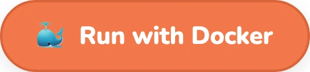
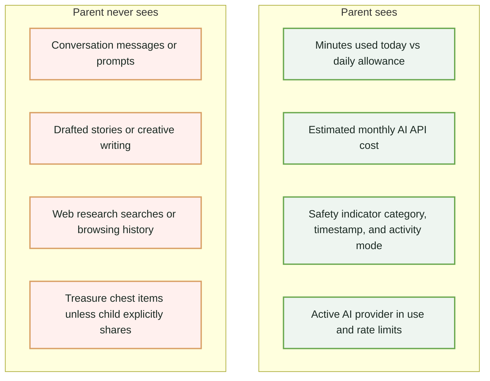
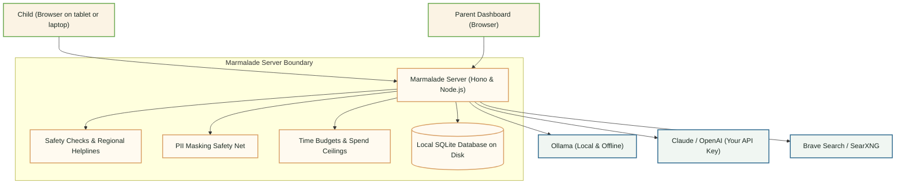

<div align="center">

[](https://github.com/j-nilesh/marmalade)
[](https://github.com/j-nilesh/marmalade)

**Stories your child has to steer, research with sources they can check, and homework help that coaches instead of cheats.**

Runs on your own computer or Raspberry Pi, with the AI model you choose. Parents set the limits. Nobody reads the chats.

<p align="center">
  <a href="#get-marmalade">
    <picture>
      <source media="(prefers-color-scheme: dark)" srcset="docs/assets/readme/button-docker-dark.webp">
      
    </picture>
  </a>
  <a href="#try-demo-mode-in-2-minutes">
    <picture>
      <source media="(prefers-color-scheme: dark)" srcset="docs/assets/readme/button-demo-dark.webp">
      
    </picture>
  </a>
  <a href="SELF_HOSTING.md">
    <picture>
      <source media="(prefers-color-scheme: dark)" srcset="docs/assets/readme/button-docs-dark.webp">
      
    </picture>
  </a>
</p>

`Docker or Node.js 20+ · Ollama (offline) or a Claude or OpenAI key · Free and open source (MIT) · Ages 6 to 16`

<p align="center">
  <a href="https://github.com/j-nilesh/marmalade/releases"></a>
  <a href="LICENSE"></a>
  <a href="https://github.com/j-nilesh/marmalade/actions"></a>
  <a href="https://github.com/j-nilesh/marmalade/pkgs/container/marmalade"></a>
</p>

</div>

---

## A treehouse, not a chatbot

[](#a-treehouse-not-a-chatbot)
[](#a-treehouse-not-a-chatbot)

Five rooms, each with a job and a natural end.

### Story Relay
[](docs/THREAT_MODEL.md)
[](docs/THREAT_MODEL.md)
*Your child steers a six-act story in their own words. The AI keeps handing back the pen.*

### Field Guide
[](docs/PROVIDER_COMPLIANCE.md)
[](docs/PROVIDER_COMPLIANCE.md)
*Research answers come with sources they can open and check, from Brave Search or your own SearXNG.*

### Study Nook
[](docs/THREAT_MODEL.md)
[](docs/THREAT_MODEL.md)
*It asks questions and breaks the project into steps. It won't write the essay.*

---

## Activities in the treehouse

[](#activities-in-the-treehouse)
[](#activities-in-the-treehouse)

---

## Parents set limits. Nobody reads the chats.

[](#parents-set-limits-nobody-reads-the-chats)
[](#parents-set-limits-nobody-reads-the-chats)

[](docs/THREAT_MODEL.md)
[](docs/THREAT_MODEL.md)

| Policy | Guarantee |
| :--- | :--- |
| **Time budgets and cooldowns.** | Daily minutes and breaks you choose. |
| **Spend caps.** | A monthly cost limit on cloud models. |
| **Safety alerts, not transcripts.** | You see a category and a time, never the words. |
| **Help comes first.** | Crisis messages show helplines right away (US/Canada 988, UK 111 / 0800 1111, India 14416 / 1098, International findahelpline.com), and alerts are held back when the disclosure concerns a grown-up at home. |

Why no transcript reader? [Read the design note in THREAT_MODEL.md](docs/THREAT_MODEL.md).

---

## What a parent sees



---

## It stops on purpose

[](#it-stops-on-purpose)
[](#it-stops-on-purpose)

<!-- Question Room turn cap (8): src/server/activities/engine.ts#L2716 -->
<!-- Story Relay max scenes (6): src/server/activities/engine.ts#L1360 -->
<!-- Trivia round questions (10): src/server/activities/engine.ts#L716 -->
<!-- Transient memory idle expiry (15m): src/server/activities/engine.ts#L46 -->
[](#it-stops-on-purpose)
[](#it-stops-on-purpose)

No streaks, no infinite feed, nothing built to keep them there one more minute.

---

## Your hardware. Your model. Your rules.

[](#your-hardware-your-model-your-rules)
[](#your-hardware-your-model-your-rules)

- **Runs at home.** A computer, a Raspberry Pi, or a private cloud instance you control.
- **Works offline.** With Ollama and a local model, nothing leaves the house.
- **Your choice of model.** Ollama, Claude or OpenAI. Gemini is blocked in child workspaces because its API terms require users to be 18+ ([details](docs/PROVIDER_COMPLIANCE.md)).
- **Personal details masked.** Emails, phone numbers, addresses, school and full names are masked before a prompt reaches a cloud provider. A safety net, not a guarantee.
- **No telemetry.** No analytics, tracking pixels or remote fonts.

[Threat model](docs/THREAT_MODEL.md) · [Provider compliance](docs/PROVIDER_COMPLIANCE.md) · [Deployer responsibilities](docs/DEPLOYER_RESPONSIBILITIES.md)

---

## Measured, not promised

[](#measured-not-promised)
[](#measured-not-promised)

| Automated Tests Passing | Outbound Network Requests in Demo Mode | Remote Scripts or Fonts Loaded | Supported Age Range |
| :---: | :---: | :---: | :---: |
| **139** | **0** | **0** | **6 to 16** |

Measured on commit `8a34289` in Demo Mode. Test results, not a guarantee. [Run the checks yourself](#run-the-checks-yourself).

---

## Under the hood

[](#under-the-hood)
[](#under-the-hood)



- **Policy lives in the server, not the prompt.** Turn caps, daily minutes, spend ceilings, and provider compliance are enforced by deterministic backend code before any LLM is called.
- **Keys never reach the browser.** Provider API keys are encrypted at rest with AES-256-GCM on your server disk and stripped from every client payload.
- **Built with lightweight, auditable standards.** React 19 and TypeScript on Vite for the client; Hono and `better-sqlite3` for the backend. Single-binary bundle with zero external database processes.

---

## Next on the list

[](#next-on-the-list)
[](#next-on-the-list)

- **Quiet Hours:** Server-enforced time windows when child activities sleep (school hours, bedtime).
- **Anti-Personification Guard:** An output filter outside the model preventing the AI from claiming sentience or pretending to be a real human friend (Kitegate-inspired).
- **"This answer seems wrong":** An inline flag giving children agency to question AI mistakes and optionally share the exchange with their parent.
- **Multi-child households:** Separate profiles, age calibrations, and allowances with sibling-proof privacy.

[View full release plan in ROADMAP.md](ROADMAP.md)

---

## Straight answers

[](#straight-answers)
[](#straight-answers)

<details>
<summary><strong>Can parents read their child's chats?</strong></summary>
<p>No. By architectural design, the parent dashboard contains no transcript reader or chat feed. Parents see minutes used today, estimated spend, and safety-alert categories, never conversation text. Children deserve a private space to explore their thoughts, governed by technology limits rather than conversation surveillance.</p>
</details>

<details>
<summary><strong>Is it safe for kids?</strong></summary>
<p>No AI system is 100% safe, which is why Marmalade combines multiple independent defenses: bounded room formats, turn caps, Socratic homework scaffolding, strict PII masking, and an application-controlled safety layer that intervenes immediately with crisis helplines on high-risk topics. When disclosures concern domestic abuse at home, notifications are handled safely without exposing the child to retaliation.</p>
</details>

<details>
<summary><strong>Does it work offline?</strong></summary>
<p>Yes. With <a href="https://ollama.com">Ollama</a> running locally, Marmalade generates stories, answers questions, and coaches homework completely offline on your home network. Zero external API bills and zero data leaving your machine.</p>
</details>

<details>
<summary><strong>What does it cost?</strong></summary>
<p>Marmalade is 100% free and open source under the MIT License. If you choose to connect commercial cloud providers (Anthropic Claude or OpenAI), you pay those providers directly under your own API account. Hard spend caps prevent unexpected bills.</p>
</details>

<details>
<summary><strong>What ages is it for?</strong></summary>
<p>Marmalade is calibrated for kids ages 6 to 16. During setup, parents set the child's age to calibrate Socratic scaffolding depth, vocabulary, and daily time allowances.</p>
</details>

<details>
<summary><strong>Why is Gemini blocked in child workspaces?</strong></summary>
<p>Google's Gemini API terms explicitly require users to be at least 18 years old. Marmalade enforces a hard provider compliance gate: Gemini can be configured by adults for parent-facing workflows, but is blocked from minor learning spaces. See <a href="docs/PROVIDER_COMPLIANCE.md">Provider Compliance</a>.</p>
</details>

<details>
<summary><strong>Can more than one child use it?</strong></summary>
<p>Today, Marmalade supports one child profile per household instance. Full multi-child support—with isolated logins, separate age calibrations, and sibling-proof privacy—is actively planned on the roadmap.</p>
</details>

---

## Get Marmalade

[](#get-marmalade)
[](#get-marmalade)

### Quickstart with Docker Compose

```bash
# 1. Clone the repository
git clone https://github.com/j-nilesh/marmalade.git
cd marmalade

# 2. Launch the sanctuary container
docker compose up -d
```

Open **`http://localhost:4120`** in your browser.

<h3 id="try-demo-mode-in-2-minutes">Try Demo Mode in 2 minutes</h3>

1. **Initialize your household (60 seconds):** Open `http://localhost:4120` to set your parent password, your child's username, and your family's time zone. (If `SETUP_TOKEN` is configured on your server, enter it during setup).
2. **Instant Demo Mode:** Marmalade starts automatically in **Demo Mode** with built-in sample responses for Ask, Research, Schoolwork, and Play. No API keys, credit cards, or external services are needed to explore.
3. **Connect real AI when ready:** Visit Parent Settings (`/parent`) anytime to connect free offline Ollama or a commercial provider (Anthropic Claude or OpenAI).

<details>
<summary><strong>Run from source with Node.js</strong></summary>

Prerequisites: Node.js 20+

```bash
git clone https://github.com/j-nilesh/marmalade.git
cd marmalade
npm ci
npm run build
npm start
```
</details>

<details>
<summary><strong>One-click private cloud hosting</strong></summary>

- **Fly.io**: Copy [`fly.example.toml`](fly.example.toml) to `fly.toml` and run `fly launch`.
- **Render**: Connect your repo using [`render.yaml`](render.yaml) with persistent disks.
- Full guide: See [SELF_HOSTING.md](SELF_HOSTING.md).
</details>

<details id="run-the-checks-yourself">
<summary><strong>Run the checks yourself</strong></summary>

Reproduce all statistics in "Measured, not promised":

```bash
# 1. Run the test suite
npm test

# 2. Run the empirical stats pipeline
npm run readme:stats

# 3. Regenerate all visual landing page assets
npm run readme:assets
```
</details>

---

## Build with us

[](#build-with-us)
[](#build-with-us)

Marmalade is built collaboratively by parents, educators, and software engineers who believe children deserve private, bounded technology.

[Contributing guide](CONTRIBUTING.md) · [Good first issues](https://github.com/j-nilesh/marmalade/labels/good%20first%20issue) · [GitHub Discussions](https://github.com/j-nilesh/marmalade/discussions) · [Report a bug](https://github.com/j-nilesh/marmalade/issues) · [Security policy](SECURITY.md)

Made by Nilesh Jahagirdar · [nileshj.com](https://nileshj.com) · MIT License
